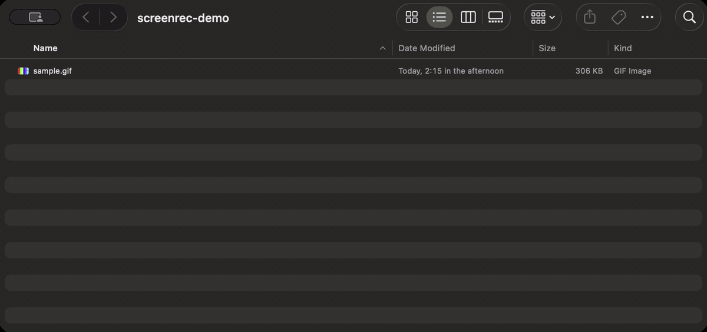

# screenrec (agent-screen-record)

Let AI agents record what they do in a macOS window, app, display, region or Chrome tab, then clean the recording up. Local only.



## What it does

screenrec watches one target while your agent (Claude Code, Claude Desktop, Codex, Cursor, a Playwright script, or you at a shell) does the work. It never drives the computer.

- **Record** a window, an app, a whole display, a region of a display, or a Chrome tab. Window capture keeps recording a window that other windows cover, and tab capture keeps recording a tab that is not the visible one (both checked on a real Mac, see [docs/TESTED.md](docs/TESTED.md)).
- **Follow** the work: `--follow-app` switches to the new window when, say, Finder opens a file in Preview; `--tab follow` switches between the tabs the agent opens.
- **Clean up**: `squeeze` removes waiting and idle time, `crop` cuts to a rectangle or trims the edges, `blur` pixelates private areas, `trim` cuts the start and end, `gif` exports a looping GIF, `frame` saves one still.
- **Local only**: no upload, no telemetry, no update checks. screenrec's only network connections are to Chrome on your own machine (loopback).

It ships as one npm package with three front ends: the `screenrec` CLI, an MCP server (`screenrec mcp`), and a Claude Code plugin.

## Install

### Requirements

- macOS 13 or newer for window, app, display and region capture.
- Node 22 or newer.
- ffmpeg 5.1 or newer (tested on 9.0.2): `brew install ffmpeg`. ffmpeg is not bundled. To use one that is not on `PATH`, set `SCREENREC_FFMPEG` (and `SCREENREC_FFPROBE`).
- To build from source: Swift (Xcode or the Command Line Tools) for the macOS capture helper.
- For hidden Chrome tabs: Chrome 144 or newer (see [Chrome](#chrome)).

### From npm

```sh
npm i -g agent-screen-record
```

The package is `agent-screen-record` (the npm name `screenrec` belongs to an unrelated package); the command it installs is `screenrec`.

### Build from source

To run your own build or change the code, install from a checkout:

```sh
git clone https://github.com/jamiusaliu/agent-screen-record.git agent-screen-record && cd agent-screen-record
npm ci && npm run build && npm run build:native
npm install -g .
```

`npm run build` compiles the TypeScript to `dist/`; `npm run build:native` compiles the macOS capture helper (`bin/screenrec-mac`). `npm install -g .` links the checkout, so the `screenrec` command runs it.

### Check the setup

```sh
screenrec doctor
```

`doctor` checks Node, ffmpeg, the macOS version, the capture helper, Screen Recording permission, Chrome's version and remote debugging, the Chrome broker and the Chrome DevTools MCP route, and prints the fix for anything missing. It never connects to Chrome.

### Screen Recording permission

The first window, display or region capture makes macOS ask for Screen Recording permission for the app that runs screenrec: your terminal, your IDE, or the agent app (for example Claude Desktop). Allow it in System Settings > Privacy & Security > Screen Recording, then quit and reopen that app. Chrome tab capture does not need it.

## Use it from your agent

### Point your agent at the installed `screenrec`

After `npm i -g agent-screen-record` (or [building from source](#build-from-source)), register `screenrec mcp` as an MCP server. The examples below assume the client finds `screenrec`, `node` and `ffmpeg` on its `PATH`; if it does not, see [When the app cannot find screenrec](#when-the-app-cannot-find-screenrec).

Claude Code:

```sh
claude mcp add screenrec -- screenrec mcp
```

Claude Desktop (`~/Library/Application Support/Claude/claude_desktop_config.json`), Cursor (`~/.cursor/mcp.json`) and other MCP clients:

```json
{
  "mcpServers": {
    "screenrec": { "command": "screenrec", "args": ["mcp"] }
  }
}
```

Codex (`~/.codex/config.toml`):

```toml
[mcp_servers.screenrec]
command = "screenrec"
args = ["mcp"]
```

When no `out` is given, recordings go to `recordings/` inside the folder the client starts the server in. Some clients start servers in `/`; when that folder is `/` or not writable, recordings go to `~/Movies/screenrec/` instead (created private to your user). An explicit `out` must be in a folder that already exists.

The MCP tools map one to one onto the CLI: `doctor`, `list_targets`, `record_start`, `record_status`, `record_mark`, `record_stop`, `screenshot`, `video_squeeze`, `video_crop`, `video_blur`, `video_trim`, `video_gif`, `video_frame`. `record_stop`, `screenshot` and `video_frame` also return an image, so the agent can check what it recorded.

### When the app cannot find screenrec

GUI apps such as Claude Desktop and Cursor often start MCP servers with a shorter `PATH` than your shell, so `screenrec`, `node` (common with nvm, or Homebrew under `/opt/homebrew/bin`) or `ffmpeg` may not be found. `bin/screenrec` starts with `#!/usr/bin/env node`, so pointing at it alone is not enough when `node` is missing. Use absolute paths for all three:

```json
{
  "mcpServers": {
    "screenrec": {
      "command": "/usr/local/bin/node",
      "args": ["/path/to/agent-screen-record/bin/screenrec", "mcp"],
      "env": { "SCREENREC_FFMPEG": "/usr/local/bin/ffmpeg", "SCREENREC_FFPROBE": "/usr/local/bin/ffprobe" }
    }
  }
}
```

Find each path in your shell: `which node`, `which ffmpeg` and `which ffprobe`; the second argument is `bin/screenrec` inside your checkout. With nvm, `which node` points into a version folder, so update the path when you switch Node versions.

### Without a global install: the plugin or npx

Claude Code plugin (adds the MCP server and a `screen-record` skill that tells the agent how to record: start before acting, use the narrowest target, add step notes, stop, squeeze, offer a GIF):

```text
/plugin marketplace add jamiusaliu/agent-screen-record
/plugin install screenrec@agent-screen-record
```

The plugin runs the server with `npx -y agent-screen-record@0.1.0 mcp`, pinned to the plugin's version, so even a plugin added from a local checkout runs the published package. A global install makes the first start faster.

Any MCP client, without a global install:

```json
{
  "mcpServers": {
    "screenrec": { "command": "npx", "args": ["-y", "agent-screen-record@0.1.0", "mcp"] }
  }
}
```

### Shell-based agents

Paste [`agents/AGENTS.snippet.md`](agents/AGENTS.snippet.md) into your `AGENTS.md` (Codex, and any agent that reads it). It gives the same guidance as the plugin skill, for the CLI.

## Quick start (CLI)

The clean-up commands work on any video. This block makes a test video with ffmpeg and runs each of them; the release clean-room test runs it exactly as written:

```bash cleanroom
screenrec version
screenrec doctor --json > /dev/null
ffmpeg -v error -f lavfi -i "testsrc2=size=640x400:rate=30:duration=4,loop=loop=60:size=1:start=30,setpts=N/30/TB" -pix_fmt yuv420p demo.mp4
screenrec squeeze demo.mp4 --json
screenrec crop demo.squeeze.mp4 --trim-edges 8
screenrec blur demo.squeeze.mp4 --box 40,40,200,60
screenrec gif demo.squeeze.mp4 --width 480
screenrec frame demo.squeeze.mp4 --at 1
```

The test video holds still for 2 seconds in the middle; `squeeze` cuts that to 0.5 s (6.0 s to 4.5 s). Each command writes a new file next to its input and never touches the input: `demo.squeeze.mp4`, `demo.squeeze.crop.mp4`, `demo.squeeze.blur.mp4`, `demo.squeeze.gif.gif` and `demo.squeeze.frame-1s.png`.

Recording on macOS (needs Screen Recording permission; this one captures the whole main display):

```bash cleanroom-mac
screenrec list displays
screenrec screenshot --display main --out shot.png
screenrec start --display main --max 5s
sleep 2
screenrec stop --json
```

A typical agent session:

```sh
screenrec start --app Finder --follow-app   # start BEFORE acting
screenrec mark "opened Downloads"           # a step note after each step
screenrec stop --json                       # prints the saved mp4 path
screenrec squeeze recordings/rec-20261022-101500.mp4
screenrec gif recordings/rec-20261022-101500.squeeze.mp4
```

Every command takes `--json`. On failure it prints `{ "ok": false, "code", "message", "fix" }` and exits 1. Run `screenrec <command> --help` for a command's flags.

### Commands

| Command | What it does |
|---|---|
| `screenrec doctor` | Checks the setup and prints a fix for each problem |
| `screenrec list windows\|displays\|tabs` | Lists targets with their ids (`tabs` accepts `--cdp`) |
| `screenrec start <target>` | Starts one recording. `--out` (an `.mp4`), `--force`, `--fps` (30; a whole number from 1 to 120), `--cursor` (hidden by default), `--max` (10m; from 1s to 24h), `--no-meta`, `--follow-app` (with `--window` or `--app`), `--ignore-app` (with `--follow-app`), `--cdp` (with `--tab`). A flag that does not apply to the target is refused |
| `screenrec status` | Running or idle, target, elapsed time, output path; for a window or app recording, `targetState` is `hidden` while the window is minimized, hidden or closed (the last frame is held) and `visible` otherwise; `screen` is `locked`, `asleep` or `off-console` while the Mac screen is not drawn (nothing is captured meanwhile) |
| `screenrec mark "<text>"` | Adds a timestamped step note (`screenrec mark -- "-x"` for text that starts with a dash) |
| `screenrec stop` | Finalises `<name>.mp4` and its `<name>.json` sidecar; `warnings` names any stretch where the screen was locked or asleep (frozen or blank in the video, also marked in the sidecar as "screen locked" / "screen unlocked"); a recording that ended itself because of a long lock reports reason `screen-locked` |
| `screenrec screenshot <target>` | One PNG (a tab needs `url:` or `title:`); works during a recording |
| `screenrec squeeze <in> [--hold 0.5]` | Keeps each still stretch for at most `--hold` seconds (`0` keeps one frame) and re-times the step notes |
| `screenrec crop <in> --rect x,y,w,h` or `--trim-edges N` | Crops in output pixels, or removes an N pixel border |
| `screenrec blur <in> --box x,y,w,h[@from-to]` or `--boxes file.json` | Pixelates, then blurs; boxes can be timed or keyframed ([example](examples/blur-boxes.json)). A box without `@from-to` (or `from`/`to`) covers the whole video; a keyframed box without them is held at its first keyframe before it and at its last after it. A box whose window starts at or after the end of the video, or in its last frame interval (at least the last 0.1 s), is refused |
| `screenrec trim <in> --from S --to S` | Keeps from..to seconds |
| `screenrec gif <in> [--width 800] [--fps 12]` | Two-pass palette GIF |
| `screenrec frame <in> --at S [--width W]` | One still frame, for checking content and measuring blur boxes |
| `screenrec chrome-broker status\|stop` | Shows or stops the background Chrome connection (see [Chrome](#chrome)) |
| `screenrec mcp` | Runs the MCP server on stdio |
| `screenrec version` | Prints the version |

Durations take `90s`, `10m`, `1h` or plain seconds. Recordings auto-stop after `--max` (10 minutes by default). One recording runs at a time; if a recorder crashed, the next `start` or `status` finalises its partial file into a playable mp4 and reports it.

## Targets

Pick exactly one per `start` or `screenshot`.

| Target | Example | Records |
|---|---|---|
| Window | `screenrec start --window "Finder:Downloads"` | One window, by `"App"`, `"App:title part"` (split on the first colon) or a window id from `list windows`. A covered window keeps recording (tested with TextEdit, and with a Finder window whose folder changed while covered). |
| App | `screenrec start --app Safari` | That app's front window at start, then the same as `--window` |
| Follow app | `screenrec start --app Finder --follow-app` | Starts on that window and switches to each new window that appears after start (tested: while Finder was recorded, a file opened in Preview with `open -a Preview`, and the recording switched to Preview), adding a step note. It reacts to new windows, not to focus, so clicking into one of your existing windows is not a reason to switch; a window you open yourself during the recording is. The terminal or IDE that ran `start` is never followed; add more with `--ignore-app <App>`. |
| Display | `screenrec start --display main` | A whole display: `main`, a number from `list displays`, or part of its name |
| Display of | `screenrec start --display-of "Safari"` | The display holding most of that window |
| Region | `screenrec start --region 0,0,1280,800 --display 2` | A rectangle in points from the display's top-left (`--display` defaults to `main`) |
| Newest tab | `screenrec start --tab newest` | The newest Chrome tab opened after start; it moves on to each tab opened later |
| Follow tabs | `screenrec start --tab follow` | Like `newest`, and also switches back when one of the tabs opened after start comes to the front again; a step note marks each switch |
| Tab by URL | `screenrec start --tab url:github.com/org/repo` | The first open tab whose URL contains the text |
| Tab by title | `screenrec start --tab title:Pull request` | The first open tab whose title contains the text |

A window that is minimized holds its last frame and the recording continues after it is restored (tested). A window that closes before `stop` still gives a playable file (tested); screenrec is designed to end the recording when the window disappears, and with `--follow-app` to hand over to the newest window that appeared after start (both unverified). If a name matches several windows, screenrec lists them instead of guessing. Real-machine results for each target are in [docs/TESTED.md](docs/TESTED.md).

## Chrome

screenrec records a Chrome tab through the Chrome DevTools Protocol, so the tab records live even while it is hidden behind another tab or another window (tested on the normal Chrome profile, see [docs/TESTED.md](docs/TESTED.md)).

### Your own Chrome

1. Use Chrome 144 or newer.
2. Open `chrome://inspect/#remote-debugging` and turn remote debugging on.
3. The first tab recording (or `screenrec list tabs`) makes Chrome ask whether to allow the connection. Click Allow. While connected, Chrome shows its automation bar.

This works with your normal profile, cookies and logins. Chrome asks on every new connection, so screenrec keeps one connection open in a background process, the Chrome broker: you click Allow **once per Chrome session**, not once per recording (tested: one Allow for three recordings). The broker listens only on `127.0.0.1` behind a random token, forwards only the few CDP calls screenrec makes (no navigation, input, cookies or scripts), and exits when Chrome closes the connection or after 30 minutes with no use (`SCREENREC_BROKER_IDLE`, in milliseconds). `screenrec chrome-broker status` shows it; `screenrec chrome-broker stop` ends it.

### A test browser

For a browser started for debugging (Playwright, Puppeteer, Chrome for Testing, or Chrome started with `--remote-debugging-port`), pass its endpoint with `--cdp http://127.0.0.1:<port>` or set `SCREENREC_CDP`. That skips the broker and the Allow dialog. Only loopback addresses are accepted.

### Without remote debugging

On macOS, `--tab url:` and `--tab title:` fall back to recording the Chrome window when the tab is the active tab of its window, with a warning. Window capture of Chrome has limits: switching the tab changes the recording, and a Chrome window that another window covers stops drawing, so the recording freezes (tested). Keep it uncovered (a second display works), or start Chrome with `--disable-backgrounding-occluded-windows`, which keeps a covered Chrome window live (tested on the default profile). `--tab newest` and `--tab follow` need remote debugging.

### What to expect in a tab recording

- Hidden tabs record live.
- If Claude in Chrome is driving the tab, its overlay is part of the page and appears in the recording (seen in two early test recordings; running screenrec's own tab recorder alongside Claude in Chrome is not verified yet): the orange edge glow, the "Claude is active in this tab group" pill, and its cursor. `screenrec crop <file> --trim-edges 8` removes the glow; the pill and the cursor stay.
- Limitation: `newest` and `follow` treat any tab opened after `start` as the agent's tab, including a tab you open yourself during the recording.

### Second route: Chrome DevTools MCP

If your agent already runs Google's [chrome-devtools-mcp](https://github.com/ChromeDevTools/chrome-devtools-mcp), it can record a tab itself with `screencast_start` and `screencast_stop`. It writes an AV1 `.mp4` at a variable frame rate; every screenrec clean-up command accepts that file and writes H.264. `screenrec doctor` reports whether it finds chrome-devtools-mcp in your agent's MCP configuration.

- It sends usage statistics to Google by default. Turn that off with `--no-usage-statistics --no-performance-crux` in its arguments, or `CHROME_DEVTOOLS_MCP_NO_USAGE_STATISTICS=1` in the environment of the agent that starts it (for example when it comes from a plugin whose arguments you cannot edit).
- It sees every tab of the Chrome profile, not only the one it records.
- It has no follow mode, step notes or auto-stop.

Use one route per Chrome session.

## Multiple monitors

- A window keeps recording when you move it to another display (tested in both directions between a 2x and a 1x display); the output size is fixed at start and later frames are scaled to fit.
- `--display` picks a display by `main`, its number in `screenrec list displays`, or part of its name. `--display-of "<window>"` picks the display that holds most of that window.
- `--region x,y,w,h --display <d>` is measured in points from that display's top-left corner and converted with that display's own scale. A region must fit inside one display (`E_REGION_SPANS_DISPLAYS` otherwise).
- One display per recording.

## Privacy

- **Local only.** Nothing is uploaded. No telemetry, no update checks. screenrec's only network connections are to Chrome on loopback (`127.0.0.1`, `localhost`, `::1`): the remote-debugging endpoint and the screenrec broker. A test fails the build if any other network call appears in the TypeScript source, and ffmpeg is only ever given local file paths. If you start screenrec through `npx`, npm itself contacts the npm registry to check the package; a global install avoids that.
- **Recordings stay out of git.** By default recordings go to `./recordings/` (for the MCP server, relative to the folder the client starts it in), which is created readable only by you, with a `.gitignore` containing `*`. When that folder is `/` or not writable, they go to `~/Movies/screenrec/`, created readable only by you. Clean-up outputs go next to their input, or to the default folder when the input's folder is not writable.
- **Narrow targets by default.** Prefer a window or a tab. `--display`, `--display-of` and `--region` print a warning: they capture notifications and every other window on that display, so turn on a Focus mode first.
- **The cursor is hidden** unless you pass `--cursor`.
- **Blur pixelates first, then blurs**, so text cannot be recovered by deblurring. Blur before you make a GIF.
- **Blur errs on the side of covering too much.** A keyframed box without `from`/`to` stays on for the whole video (held at its first and last keyframe), and a box whose time window misses the video (or starts within the last 0.1 s, where it could miss the last frame) is an error, never a silent no-op. Give `from`/`to` only when you want a box to switch off.
- **Listing tabs shows every tab.** `list tabs` (and `list_targets` with kind tabs) returns the title and URL of every tab in the Chrome profile to the agent, not only the one you mean to record.
- **The sidecar is sensitive.** `<name>.json` next to each recording holds window titles, URLs and step notes. Keep secrets out of `mark`; `--no-meta` skips the sidecar.
- **Nothing is overwritten by accident.** Clean-up commands never overwrite their input; without `--out` they pick a new name (`<in>.<command>.<ext>`, then `-2`, `-3`). An explicit `--out` that already exists, or whose `.json` sidecar would replace an existing file, is refused. Add `--force` to replace it; `--force` never replaces the input (or a link to it), and `--force` without `--out` is refused. Output is written to a temporary file and moved into place only on success, so a failed run leaves the old file alone.
- **The macOS recording indicator is never hidden.** The MCP tools tell the agent to say in chat when it starts and stops recording.
- **A locked screen is not recorded.** While a capture runs and the screen is locked, macOS shows "Your screen is being observed" on the lock screen; that is macOS's own notice, and nothing is captured while the screen is locked.
- **A running recording takes screenshots for other programs of yours.** While a recording runs, programs running as your user can ask it for a screenshot of any window or display; it writes only into screenrec's private state folder, never to a path the request names.

## Troubleshooting

Every error has a stable code and a one-line fix, also printed by the command itself. Set `SCREENREC_DEBUG=1` for full details.

An MCP host that starts the server in a macOS-protected folder (Desktop, Documents, Downloads) may be allowed to check the folder but not to write to it; the error then names the folder. Pass an `out` in another folder, or give the host app access in System Settings > Privacy & Security > Files and Folders.

| Code | Common causes | Fix |
|---|---|---|
| `E_BAD_ARGS` | Unknown flag or command, no target or more than one, bad region, box or duration, `--out` exists, `--out` in a folder that does not exist, `--force` without `--out` | Run `screenrec <command> --help`. Use exactly one of `--window`, `--app`, `--display`, `--display-of`, `--region` (with `--display`) or `--tab`. For an existing `--out`: choose a different path, add `--force` to replace it, or omit `--out` to get a new name. An explicit `--out` never creates folders: create the folder first or choose another `--out`. |
| `E_PERMISSION` | Screen Recording permission not granted | Open System Settings > Privacy & Security > Screen Recording, enable the app that runs screenrec (your terminal or IDE), then quit and reopen that app. |
| `E_NO_FFMPEG` | ffmpeg not on `PATH` | Install it (macOS: `brew install ffmpeg`; Windows: `winget install ffmpeg`; Linux: your package manager), or set `SCREENREC_FFMPEG`. |
| `E_FFMPEG_FAILED` | The input is not a finished, playable video | Check the input file plays; re-run with `SCREENREC_DEBUG=1` for the full command. |
| `E_TARGET_NOT_FOUND` | No window, app window, display or tab matches; or "No displays are available" because the screen is locked or the displays are asleep | For a locked or sleeping screen: unlock the Mac or wake the displays, and for unattended runs keep them awake with `caffeinate -d` running alongside. Otherwise run `screenrec list windows`, `list displays` or `list tabs` and pass `"App"`, `"App:title"`, a window id, `main`, a display number or part of a name. For `--app`, open a window in that app first. |
| `E_TARGET_AMBIGUOUS` | Several windows match | Add part of the title (`"App:title"`) or pass the window id; the error lists the candidates. |
| `E_ALREADY_RECORDING` | A recording is already running | Run `screenrec stop` first (one recording at a time). |
| `E_NOT_RECORDING` | `stop` or `mark` with nothing recording | Start one with `screenrec start --window <App>`. |
| `E_CDP_UNAVAILABLE` | Chrome remote debugging is off, the Allow dialog was declined or not answered, or the `--cdp` address is not loopback | In Chrome 144+, open `chrome://inspect/#remote-debugging` and enable it, then click Allow in Chrome's dialog and retry; or start a test browser and pass `--cdp http://127.0.0.1:<port>`. |
| `E_REGION_SPANS_DISPLAYS` | The region does not fit the chosen display | Regions are measured in points from the top-left of the chosen display and must stay inside it. |
| `E_HELPER_CRASHED` | The capture helper is missing, timed out or failed to write; or an unexpected internal error (the message starts with `internal error:`) | Run `npm run build:native` (from source) or reinstall agent-screen-record. If a macOS Screen Recording dialog is waiting, answer it. Check the output folder exists, is writable and has free space. Otherwise re-run with `SCREENREC_DEBUG=1` and report the output. |
| `E_NO_FRAMES` | The target never drew a frame (minimized, on another Space, the screen locked or asleep, or stopped within moments of starting) | Un-minimize the window or move it to the current Space. Unlock or wake the screen (`caffeinate -d` keeps it awake). For tabs, make sure the agent opened one after start. Record for at least 2 seconds. |
| `E_UNSUPPORTED_PLATFORM` | Window, display or region capture off macOS; on Windows, any recording or use of your own Chrome through the broker | On Windows, v1 runs the clean-up commands only. On Linux, `--tab` may work but is unverified. Record on a Mac. |

## Known limits

From [docs/TESTED.md](docs/TESTED.md), which holds every real-machine claim with its evidence:

- Tested on one machine: an Intel Mac (macOS 26.7.1) with a built-in 2x display and an external 1x display, Chrome 155 and 156. Apple silicon is unverified.
- Not verified yet: that notifications stay out of a window recording (the test was inconclusive), a covered Safari window, a window on another Space, a full-screen app, unplugging a display during a recording, a recording ending by itself when its window closes, the `--follow-app` hand-over when the followed window closes, and screenrec's tab recorder running alongside Claude in Chrome.
- Intermittent: in the first matrix run, three recordings in a row failed at start (`E_TARGET_NOT_FOUND` "No displays are available") or at stop (`E_NO_FRAMES`) with the screen awake; all passed on rerun. Once, a window moved from the external display to the main one was encoded at 540x450 instead of 600x500. Neither has been reproduced.
- Your own Chrome (remote debugging plus Allow) is verified with Google Chrome only; Edge and Brave are unverified. Firefox and Safari can be recorded only as windows.
- Chrome asks for Allow on every new connection, which is why the broker exists. A crashed broker is replaced on next use, which costs one more Allow.
- `--tab newest` and `--tab follow` cannot tell your tabs from the agent's (see [Chrome](#chrome)). If attaching to a new tab fails and that page never changes, the recording stays on the previous tab until the page loads or changes.
- One recording at a time, one display per recording, no audio.
- A long lock ends a recording: in the live check, about 30 s after the screen locked the capture stopped and the recording ended by itself with reason `screen-locked` (saved, with a warning naming the locked stretch). A short lock is marked and the recording continues. Keep the screen unlocked, or run `caffeinate -d`, for long recordings.

## Platforms

- **macOS 13+**: everything above.
- **Windows**: the clean-up commands only (`squeeze`, `crop`, `trim`, `blur`, `gif`, `frame`). They are plain Node and ffmpeg but unverified on a real Windows machine. Every kind of recording, Chrome tabs included, and the Chrome broker are refused with `E_UNSUPPORTED_PLATFORM`, because they rely on POSIX process groups and `ps`.
- **Linux**: the clean-up commands, and possibly Chrome tab capture (`--tab`), are expected to work but are unverified. Window, app, display and region capture are macOS only.

## Contributing and security

See [CONTRIBUTING.md](CONTRIBUTING.md) for the build and the test suites, and [SECURITY.md](SECURITY.md) to report a vulnerability privately.

## Licence

MIT. See [LICENSE](LICENSE).
